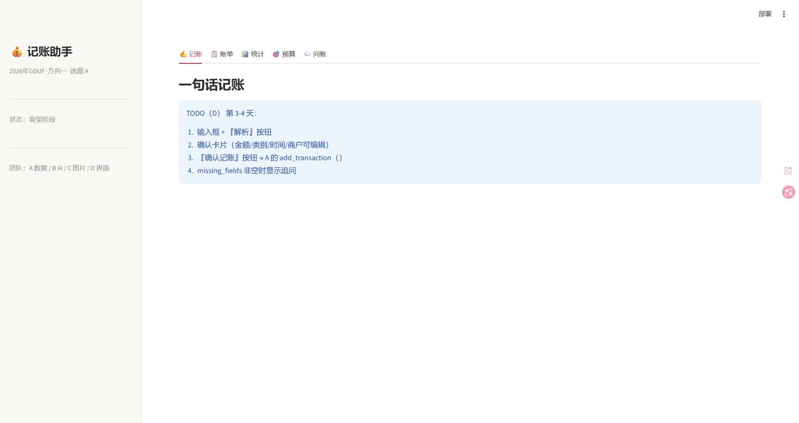

# 个人记账与消费分析 AI 助手

> 2026 GDUF 人工智能工作室二轮考核 · 方向一 · 选题 A
> 队伍：**A / B / C / D** 4 人 · 零基础 · Python · 15 天

**一句话**：用人话记账、拍照记账、用一句话查账，超预算了提醒你。



---

## 一、目录结构

> 代码按**功能**分文件夹，不按人分。每个人维护哪些文件夹见 [`docs/01-分工与排期.md`](docs/01-分工与排期.md)。
> 要动别人维护的文件，先在群里说一声。

```
accounting-assistant/
├── app/                     应用代码
│   ├── config.py            配置（从 .env 读）
│   ├── constants.py         10 个分类、告警阈值
│   ├── money.py             金额换算（元 ↔ 分）
│   ├── api.py               REST 接口（已砍，见 docs/04-未完成与取舍.md）
│   ├── db/                  建表 SQL、数据库连接
│   ├── services/            账单存取、统计、预算判断
│   ├── llm/                 模型调用、prompt、解析、离线兜底
│   ├── ocr/                 小票 / 截图识别
│   └── ui/                  5 个页面
│       └── main.py          Streamlit 入口
├── scripts/                 工具脚本（生成示例数据）
├── tests/                   单元测试
├── docs/                    01 分工排期 / 02 参考项目 / 03 问题解决 / 04 未完成取舍 / 05 任务板
├── data/                    运行时数据库（不提交）
├── assets/                  截图、架构图（README 里要显示）
├── samples/receipts/        测试用的小票图片
├── requirements.txt         依赖清单（版本已锁定）
├── requirements.lock.txt    完整版本快照（装完后生成）
├── Dockerfile               容器化
├── docker-compose.yml       Docker 一键启动
├── run.bat / run.sh         本地一键启动
├── .env.example             环境变量模板（复制成 .env 后填 Key）
└── README.md                本文件
```

| 模块 | 主要维护人 | 放什么 |
|---|---|---|
| `app/db/` `app/services/` | A | 建表、账单增删改查、统计、预算判断 |
| `app/llm/` | B | 调模型、3 个 prompt、3 个解析函数、离线兜底 |
| `app/ocr/` | C | 小票 / 支付截图识别 |
| `app/ui/` | A / B / C | 5 个页面，按「谁产数据谁画页面」分，见下节 |
| `app/config.py` `app/constants.py` `app/api.py` `Dockerfile` | A | 配置、常量、接口、容器化 |
| `scripts/` | C | 生成示例数据 |
| `tests/` | 各模块作者 | 文件名前缀写模块名，见 `tests/README.md` |
| `docs/` | 全员 | 文档 |

---

## 二、5 个页面怎么分（谁产数据谁画页面）

| 页面 | 维护人 | 说明 |
|---|---|---|
| `page_record.py` 记账页 | **C** | 输入框 + 确认卡片；卡片里显示什么、缺字段怎么提示由 B 定 |
| `page_bills.py` 账单列表 | **C** | 调 A 的 `list_transactions`，按天分组、筛选、小计 |
| `page_stats.py` 统计页 | **A** | 调自己写的 `get_stats()`，饼图 + 月度折线 |
| `page_budget.py` 预算页 | **A** | 调自己写的 `check_budget()`，进度条 + 三色告警 |
| `page_chat.py` 对话页 | **B** | 调自己写的 `parse_query()`，消息气泡 + 示例问题按钮 |

> 好处：每个人写的页面都是自己最熟的那个函数，不用来回问"你返回什么结构"。

---

## 三、快速开始

### 1. 装环境（第 1 天做一次）

```bash
python -m venv .venv

# Windows
.venv\Scripts\activate
# macOS / Linux
source .venv/bin/activate

pip install -r requirements.txt
```

> **国内网络装依赖慢的话**，可以先换镜像源（可选，不是必须的）：
> ```bash
> pip config set global.index-url https://mirrors.aliyun.com/pypi/simple/
> ```

装完后留一条完整版本快照，方便队友和你装出完全一样的环境：

```bash
pip freeze > requirements.lock.txt
```

> ⚠️ **PowerShell 里用 `>` 生成的是 UTF-16 编码**，GitHub 网页会显示成乱码。
> 用 cmd 执行这条命令，或者 PowerShell 里改成：
> `pip freeze | Out-File -Encoding utf8 requirements.lock.txt`

> 仓库里已经带了一份 `requirements.lock.txt`（57 个包，含全部间接依赖）。
> 想要和使用者**完全一致**的环境，可以改用它：`pip install -r requirements.lock.txt`

### 2. 配密钥

```bash
copy .env.example .env      # Windows
cp .env.example .env        # macOS / Linux
```

然后编辑 `.env`，填两家 API Key（文本模型 + 视觉模型）。

> ⚠️ **`.env` 绝对不能提交。** 它已经在 `.gitignore` 里了，别 `git add -f`。

### 3. 验证模型能不能用（30 秒）

```bash
python scripts/check_models.py
```

输出里 `text : OK` 和 `vision : OK` 才算配好。不通过时它会告诉你原因（Key 错 / 模型名错 / 额度不足）。

### 4. 初始化数据库 + 示例数据

```bash
python -c "from app.db.conn import init_db; init_db()"
python scripts/generate_sample_data.py
```

### 5. 启动

```bash
streamlit run app/ui/main.py
```

或者直接双击 `run.bat`（Windows）/ 运行 `bash run.sh`（macOS、Linux）。

浏览器打开 http://localhost:8501

### 6. Docker（第 5 天后可用）

```bash
docker compose up -d --build
```

或者手动：

```bash
docker build -t accounting-assistant .
docker run -p 8501:8501 --env-file .env -v "%cd%/data:/app/data" accounting-assistant
```

---

## 四、团队分工

详见 [`docs/01-分工与排期.md`](docs/01-分工与排期.md)。参考资料见 [`docs/02-参考项目.md`](docs/02-参考项目.md)。

## 五、四项功能与验证方式

| 功能 | 怎么验证 | 状态 |
|---|---|---|
| **自然语言记账** | 记账页输入「午饭25，和同事AA」→ 点解析 → 确认卡片 → 保存 → 账单页能看到 | 🟡 开发中 |
| **拍照记账** | 记账页上传 `samples/receipts/sample_01_shaxian.png` → 识别出金额 → 确认入库 | 🟡 开发中 |
| **自动统计** | 统计页看分类饼图、月度趋势；数字与账单页合计一致 | ⬜ 待开发 |
| **预算超支** | 设 800 元餐饮预算，再录 920 元餐饮 → 预算页进度条变红并提示超支 | ⬜ 待开发 |

> **没配 Key 也能跑**：`.env` 里 `USE_MOCK_LLM=true` 时走 `app/llm/mock_llm.py` 的离线规则，
> 演示不会因为断网或额度用完而翻车。

---

## 六、当前进度

- [x] 第 1 天：环境搭建，5 个页面骨架能打开
- [x] 第 2 天：三人核对接口（9 个公共字段对齐）；文本模型与视觉模型实测通过
- [x] 第 3-4 天：`add_transaction` / `list_transactions` / `get` / `update` / `delete` 完成并自测
- [x] 第 4 天：C 提交记账页、账单页、小票识别、示例数据与单元测试
- [ ] 第 5-6 天：解析接入 + 主链路端到端打通（11/26 里程碑）
- [ ] 第 7-10 天：统计、查账、预算、小票全流程
- [ ] 第 11-13 天：Docker 完善、测试补全、README 统稿、陌生人复现
- [ ] 第 14-16 天：代码冻结、彩排、提交

## 七、已知问题与未完成部分

1. **B 的离线解析金额会误抓日期**：「11月20号充话费50」现在得到 11 元，应为 50。
   已登记在 `docs/05-任务板.md`，修好后重新接入。
2. **小票识别只取总额**：一张小票多笔明细时先只记总额，不拆单（见 `docs/04-未完成与取舍.md`）。
3. **界面样式未打磨**：优先保证功能可演示，视觉细节留到第 13 天。
4. **无多用户**：单机 SQLite，不做登录与账号隔离。
